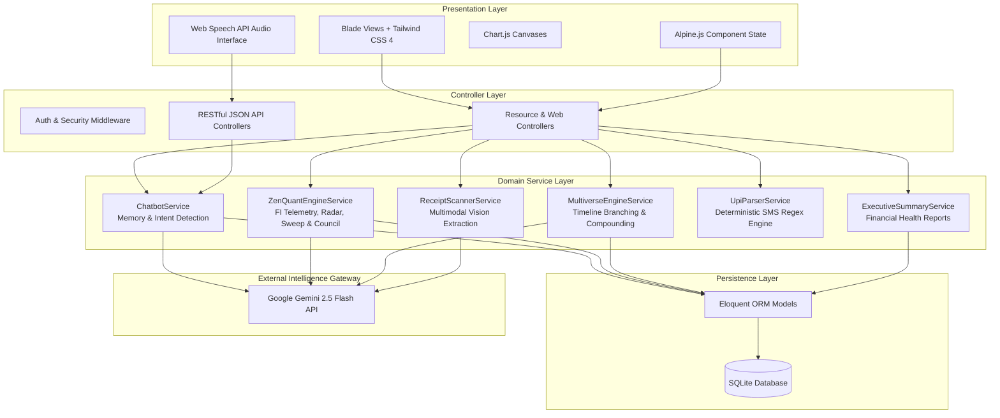

<p align="center">
  <h1 align="center">💎 FinSight AI</h1>
  <p align="center">
    <strong>Intelligent Personal Finance, Financial Physics & Predictive Analytics Platform</strong>
  </p>
  <p align="center">
    <em>Transforming passive personal accounting into active financial physics, autonomous AI council deliberations, branching multiverses, and real-time compounding telemetry.</em>
  </p>
</p>

<p align="center">
  
  
  
  
  
  
  
</p>

---

## 📑 Table of Contents

- [Overview & Philosophy](#-overview--philosophy)
- [System Architecture](#-system-architecture)
- [Key Features](#-key-features)
  - [1. Financial Independence Velocity ($V = C - B$)](#1-financial-independence-velocity-v--c---b)
  - [2. Autonomous AI Capital Council (War Room Deliberations)](#2-autonomous-ai-capital-council-war-room-deliberations)
  - [3. 4-D Kakeibo Karma Radar & Hedonic Treadmill](#3-4-d-kakeibo-karma-radar--hedonic-treadmill)
  - [4. Automated Overnight Cash Sweep (Idle Cash Arbitrage)](#4-automated-overnight-cash-sweep-idle-cash-arbitrage)
  - [5. Financial Time Machine (Monte Carlo Life & Disaster Simulator)](#5-financial-time-machine-monte-carlo-life--disaster-simulator)
  - [6. Financial Multiverse & AI Digital Twin ("Git for Your Money")](#6-financial-multiverse--ai-digital-twin-git-for-your-money)
  - [7. Impulse Shield & 48-Hour Temptation Vault](#7-impulse-shield--48-hour-temptation-vault)
  - [8. JARVIS Voice CFO](#8-jarvis-voice-cfo)
  - [9. Instant UPI / Bank SMS Auto-Parser & OCR Receipt Scanner](#9-instant-upi--bank-sms-auto-parser--ocr-receipt-scanner)
  - [10. Core Personal Finance & Portfolio Management](#10-core-personal-finance--portfolio-management)
  - [11. Dual-Persona AI Chatbot with Conversational Memory](#11-dual-persona-ai-chatbot-with-conversational-memory)
  - [12. Glassmorphism UI & Dark/Light Theme Engine](#12-glassmorphism-ui--darklight-theme-engine)
- [Mathematical Formulations](#-mathematical-formulations)
- [Directory Structure](#-directory-structure)
- [Tech Stack](#-tech-stack)
- [Getting Started](#-getting-started)
- [Automated Testing](#-automated-testing)
- [API Reference](#-api-reference)
- [Academic Affiliation & Credits](#-academic-affiliation--credits)
- [License](#-license)

---

## 🌟 Overview & Philosophy

Traditional personal finance applications act merely as **passive ledgers**—they require tedious manual record-keeping, only look backwards in time, and provide boilerplate advice that ignores real-life behavioral economics and compounding math.

**FinSight AI** re-engineers personal finance by introducing **Financial Physics**:
1. **Dynamic Velocity over Static Snapshots:** Continuous measurement of your real-time capital generation velocity against your living burn rate down to the sub-paise level at 60 FPS.
2. **Pre-Purchase Friction over Post-Facto Regret:** Instead of lamenting spent money at month-end, FinSight introduces pre-purchase deliberative barriers like the **Impulse Shield (48h Vault)** and the **Autonomous AI Capital Council**.
3. **Branching Timelines ("Git for Your Money"):** Fork alternative financial lives (e.g., career pivots, home purchases, sabbatical years), simulate their long-term trajectories, compare visual diffs, and merge back into reality.
4. **Resilient Hybrid Intelligence:** Google Gemini 2.5 Flash powers conversational financial intelligence, multimodal receipt OCR scanning, and voice CFO queries, backed by a deterministic 15-topic local fallback engine.

---

## 🏗 System Architecture

FinSight AI is built on a clean 5-tier architecture adhering to the MVC pattern and Single Responsibility Principle:



---

## 🚀 Key Features

### 1. Financial Independence Velocity ($V = C - B$)
- **Escape Velocity Telemetry:** Tracks whether your invested capital generates yield faster than your life burns cash.
- **60 FPS Live Sub-Paise Ticker:** A high-precision client-side JavaScript accumulator renders your net worth growing or depleting in real-time without CPU thrashing.
- **Escape Capital Threshold:** Dynamically calculates your target freedom fund:
  $$\text{Capital Required} = \frac{\text{Annual Living Expenses}}{\text{CAGR}}$$

### 2. Autonomous AI Capital Council (War Room Deliberations)
Before making an expensive impulse purchase, submit the proposal to an automated **3-Agent AI Capital Council**:
- **Behavioral & Mindful Audit:** Assesses emotional clutter, intentional utility, and hedonic adaptation risk.
- **Quantitative Opportunity Cost:** Calculates the 10-year compounding lost value of that capital invested in index funds (e.g., Nifty 50 at 12% CAGR).
- **Productivity & Growth ROI:** Evaluates career upside, time leverage, and practical durability.
- **Consensus Verdict:** Issues an explicit `APPROVED`, `CONDITIONAL`, or `VETOED` ruling with clear rationales.

### 3. 4-D Kakeibo Karma Radar & Hedonic Treadmill
Categorizes all expenditures into the 4 classic Japanese budgetary pillars:
1. **Survival (Needs):** Housing, groceries, health, utilities.
2. **Soul (Culture & Upskilling):** Books, fitness, learning, courses.
3. **Hedonic (Discretionary Wants):** Luxury dining, impulse gadget upgrades, recreation.
4. **Chaos (Unexpected/Unclassified):** Unplanned spending and financial leakage.
Visualized via interactive **Chart.js Radar Charts** and calculates your **Hedonic Ratio** ($\text{Discretionary} / \text{Soul}$) to detect lifestyle inflation.

### 4. Automated Overnight Cash Sweep (Idle Cash Arbitrage)
- Inspired by the *Yu'e Bao (余额宝)* overnight money market sweep.
- Segregates an operating 30-day safety buffer and calculates the arbitrage return of sweeping surplus idle bank balances (typically earning 2.7%) into liquid overnight funds (earning ~7.2%).
- Displays daily, monthly, annual, and 10-year compounding yields gained from idle cash optimization.

### 5. Financial Time Machine (Monte Carlo Life & Disaster Simulator)
- **Life Stage Simulation:** Simulates major life milestones (e.g., MBA degree, marriage, child birth, home mortgage, career sabbatical) across customizable year horizons.
- **Disaster Stress-Testing:** Subject your finances to black-swan events (medical emergencies, 6-month job loss, market drawdowns).
- **Compounding Trajectory:** Generates side-by-side comparative projections of net worth, liquidity buffers, and emergency runway.

### 6. Financial Multiverse & AI Digital Twin ("Git for Your Money")
- **Branch Alternate Timelines:** Branch out speculative scenarios (e.g., *"Quit job to freelance"*, *"Aggressive FI/RE by 42"*, *"Purchase Luxury EV on EMI"*).
- **Visual Delta Comparison:** Inspect diff tables displaying net worth divergences, savings rate shifts, and timeline changes.
- **Future-Self AI Chat:** Speak with an AI simulation of your future persona living inside that specific branched timeline to understand lifestyle trade-offs.
- **Merge Back to Reality:** Promote a successful branched simulation to your active financial plan with one click.

### 7. Impulse Shield & 48-Hour Temptation Vault
- **Psychological Cooldown Vault:** Intercept impulse purchase desires and place them into a locked 48-hour cooldown holding cell.
- **Life-Energy Hours Converter:** Computes exactly how many hours of your finite working life were traded to earn the purchase price:
  $$\text{Working Hours} = \frac{\text{Purchase Price}}{\text{Effective Hourly Wage}}$$
- **10-Year Opportunity Cost Calculator:** Shows the future value had those funds been invested into a compounding equity index.
- **Resist vs. Buy Actions:** When the 48-hour timer unlocks, celebrate resisting the purchase and log saved money into your investment goals!

### 8. JARVIS Voice CFO
- Integrated **Web Speech API** voice recognition interface for hands-free financial management.
- Instant vocal queries: *"Jarvis, how much did I spend this week?"*, *"Jarvis, what is my escape velocity?"*, or *"Log Rs 450 for lunch"*.
- Responds with synthesised auditory feedback and real-time dashboard telemetry updates.

### 9. Instant UPI / Bank SMS Auto-Parser & OCR Receipt Scanner
- **Deterministic UPI / SMS Parser:** Paste raw bank SMS notifications (HDFC, SBI, ICICI, Axis, Paytm, PhonePe, GPay). Extracts amount, type (debit/credit), merchant, account tail digits, and auto-categorizes with regular expressions.
- **Multimodal Receipt OCR:** Upload paper receipts, invoices, or grocery bills. Powered by Gemini 2.5 Flash's vision engine to extract line items, merchant details, dates, and amounts into clean JSON.

### 10. Core Personal Finance & Portfolio Management
- **Income & Expense Tracking:** Multi-source recurring income and granular expense categorization.
- **Smart Category Budgets:** Configurable spending limits with automated progress meters and dynamic warning thresholds (80% yellow caution, 100% red critical alert).
- **Target Goals:** Savings targets with target dates, visual progress milestones, and remaining monthly contributions needed.
- **Investment Portfolio:** Track stocks, mutual funds, gold, fixed deposits, and real estate, including current vs. invested value and unrealized gains.
- **Competitor & Rental Benchmarking:** Benchmark living costs and rental properties against local peers.
- **Executive PDF / Printable Reports:** Professional balance sheets, income statements, and category distribution reports formatted for print and PDF export.

### 11. Dual-Persona AI Chatbot with Conversational Memory
- **Dual Personality Engine:**
  - **💼 Professional CFO Mode:** Structured, analytical, constructive financial advisory.
  - **🔥 Roast Mode:** Brutally honest, hilarious, tough-love critique of bad spending habits.
- **Conversational Memory:** Preserves multi-turn session context to recall prior questions and answers.
- **Dynamic 15-Topic Local Fallback:** If the external API is unreachable or unconfigured, an intelligent rule-based expert engine seamlessly handles budgeting, investing, debt, tax, and FIRE questions.

### 12. Glassmorphism UI & Dark/Light Theme Engine
- Polished, ultra-modern UI designed with **Tailwind CSS 4** and **Alpine.js**.
- Custom glassmorphic cards, gradient accents, responsive sidebar navigation, and fluid animations.
- Persistent system/user preference dark-light mode toggle without flash of unstyled content (FOUC).

---

## 🧮 Mathematical Formulations

### 1. Second-by-Second Financial Independence Velocity

$$\text{Yield per Second } (C) = \frac{\text{Invested Assets} \times r}{31,536,000}$$

$$\text{Burn per Second } (B) = \frac{\text{Monthly Living Expenses}}{2,592,000}$$

$$\text{Net Velocity } (V) = C - B$$

*Where $r = 12\%$ is the default annualized equity CAGR, $31,536,000$ represents seconds per year, and $2,592,000$ represents seconds per 30-day month.*

### 2. Compounding Opportunity Cost

$$FV = P \times (1 + r)^t$$

*For an impulse purchase of amount $P$, $FV$ projects the portfolio value after $t = 10$ years assuming $r = 12\%$ annualized equity compounding.*

### 3. Life-Energy Time Debt

$$\text{Hours of Life Traded} = \frac{\text{Purchase Amount}}{\text{Monthly Income} \,/\, (\text{Working Days} \times \text{Hours per Day})}$$

### 4. Least-Squares Linear Regression Cash Flow Forecasting

Given historical monthly savings $(x_i, y_i)$ for $n$ periods:

$$m = \frac{n \sum (x_i y_i) - \sum x_i \sum y_i}{n \sum x_i^2 - (\sum x_i)^2}, \quad c = \frac{\sum y_i - m \sum x_i}{n}$$

$$\hat{y}_{t+k} = m \cdot (t+k) + c$$

---

## 📁 Directory Structure

```plaintext
finsight-ai/
├── app/
│   ├── Http/
│   │   ├── Controllers/
│   │   │   ├── Api/
│   │   │   │   └── ChatApiController.php       # JSON API for chatbot
│   │   │   ├── BudgetController.php            # Budget CRUD & threshold monitoring
│   │   │   ├── ChatController.php              # Chatbot web interface & personas
│   │   │   ├── CompetitorController.php        # Peer & competitor benchmarking
│   │   │   ├── DashboardController.php         # Analytics, telemetry & executive reports
│   │   │   ├── ExpenseController.php           # Expense tracking & categorisation
│   │   │   ├── GoalController.php              # Financial goal milestone tracker
│   │   │   ├── IncomeController.php            # Multi-stream income ledger
│   │   │   ├── ImpulseShieldController.php     # 48h temptation vault & SMS parsing
│   │   │   ├── InvestmentController.php        # Portfolio & asset management
│   │   │   ├── JarvisController.php            # Voice CFO audio intelligence
│   │   │   ├── MultiverseController.php        # Timeline branching & future self
│   │   │   ├── QuickTransactionController.php  # Quick modal, OCR & demo seeding
│   │   │   ├── TimeMachineController.php       # Monte Carlo disaster simulator
│   │   │   └── ZenQuantNexusController.php     # Capital council, radar & sweep
│   │   └── Resources/
│   │       └── ChatHistoryResource.php         # JSON API transformer
│   ├── Models/
│   │   ├── Budget.php                          # Category budget model
│   │   ├── ChatHistory.php                     # Persistent conversation logs
│   │   ├── Competitor.php                      # Peer cost tracking model
│   │   ├── Expense.php                         # Expense model with date & category
│   │   ├── FinancialTimeline.php               # Multiverse branching timeline model
│   │   ├── Goal.php                            # Goal targets and milestones
│   │   ├── ImpulseItem.php                     # Cooldown vault impulse item model
│   │   ├── Income.php                          # Income stream model
│   │   ├── Investment.php                      # Asset portfolio model
│   │   ├── User.php                            # User model with Eloquent relations
│   │   └── WarRoomDeliberation.php             # Stored AI council rulings
│   ├── Services/
│   │   ├── ChatbotService.php                  # Gemini integration & 15-topic fallback
│   │   ├── CompetitorAnalysisService.php       # Comparative benchmarking heuristics
│   │   ├── ExecutiveSummaryService.php         # Automated balance sheet & health brief
│   │   ├── MultiverseEngineService.php         # Timeline math, cloning & merge logic
│   │   ├── ReceiptScannerService.php           # Gemini Vision OCR bill scanner
│   │   ├── UpiParserService.php                # Deterministic bank/UPI SMS regex
│   │   └── ZenQuantEngineService.php           # Physics velocity, radar & AI council
│   └── helpers.php                             # Currency formatting (format_money)
├── database/
│   ├── migrations/                             # Schema definitions with decimal precision
│   └── seeders/
│       └── DemoDataSeeder.php                  # Realistic demo data suite
├── resources/
│   ├── css/
│   │   └── app.css                             # Tailwind CSS 4 theme & glassmorphism
│   ├── js/
│   │   ├── app.js                              # Alpine.js & Chart.js setup
│   │   └── theme.js                            # Dark/light mode theme engine
│   └── views/
│       ├── chat/                               # Conversational AI interface
│       ├── impulse-shield/                     # 48-Hour vault & SMS parser UI
│       ├── multiverse/                         # Branching multiverse UI & diff views
│       ├── nexus/                              # Zen & Quant Nexus, council & radar
│       ├── reports/                            # Executive financial statements
│       ├── time-machine/                       # Monte Carlo life & disaster simulator
│       └── dashboard.blade.php                 # Core financial control center
├── routes/
│   ├── web.php                                 # Authenticated web application routes
│   └── api.php                                 # Programmatic REST endpoints
├── tests/
│   └── Feature/                                # 57 PHPUnit automated test suites
├── report/
│   └── finsight_ai_project_report.tex          # Complete LaTeX academic project report
├── start_finsight.sh                           # One-touch launch script (Backend + Vite)
└── composer.json                               # Dependencies and autoloader config
```

---

## 🛠 Tech Stack

| Layer | Technologies |
|---|---|
| **Backend Framework** | Laravel 13.x (PHP 8.3) |
| **Persistence / Database** | SQLite (Production ready with relational integrity & foreign keys) |
| **Frontend Styling** | Tailwind CSS 4.x with custom glassmorphism styles |
| **Client Reactivity** | Alpine.js 3.x |
| **Data Visualisation** | Chart.js 4.x (Radar charts, Line graphs, Bar charts) |
| **Voice Interface** | HTML5 Web Speech API (SpeechRecognition & SpeechSynthesis) |
| **Generative AI** | Google Gemini 2.5 Flash API (Structured JSON & Multimodal Vision) |
| **Testing** | PHPUnit 12.x (57 automated tests, 220 assertions) |
| **Build Tooling** | Vite 8.x & Composer |

---

## ⚡ Getting Started

### Prerequisites

Ensure you have the following installed on your machine:
- **PHP** $\ge 8.2$ (PHP 8.3 recommended) with extensions: `pdo_sqlite`, `curl`, `mbstring`, `xml`
- **Composer** $\ge 2.5$
- **Node.js** $\ge 18.0$ and **npm**

### Step-by-Step Installation

1. **Clone the Repository**
   ```bash
   git clone https://github.com/shijo14/finsight-ai.git
   cd finsight-ai
   ```

2. **Install PHP & Node Dependencies**
   ```bash
   composer install
   npm install
   ```

3. **Configure Environment Variables**
   ```bash
   cp .env.example .env
   php artisan key:generate
   ```

4. **Add Google Gemini API Key (Optional but Recommended)**
   Open `.env` and configure your free Google Gemini API key:
   ```env
   GEMINI_API_KEY=your_gemini_api_key_here
   ```
   *(Note: If omitted, FinSight AI automatically activates its comprehensive 15-topic local fallback engine!)*

5. **Run Database Migrations & Seed Demo Data**
   ```bash
   php artisan migrate
   php artisan db:seed --class=DemoDataSeeder
   ```

6. **Build Frontend Assets**
   ```bash
   npm run build
   ```

7. **Launch the Application**
   You can start both the Laravel server and Vite with the included one-touch script:
   ```bash
   chmod +x start_finsight.sh
   ./start_finsight.sh
   ```
   Or run the standard Laravel development server:
   ```bash
   php artisan serve
   ```
   Access the dashboard at **`http://127.0.0.1:8000`**!

---

## 🧪 Automated Testing

FinSight AI contains a rigorous automated testing suite covering all financial physics calculations, multi-agent council deliberations, conversational memory, OCR scanners, and timeline simulations.

Run the test suite with:
```bash
php artisan test
```

### Test Suite Summary:
```plaintext
 PASS  Tests\Feature\ChatbotTest
 PASS  Tests\Feature\ImpulseShieldTest
 PASS  Tests\Feature\InvestmentTest
 PASS  Tests\Feature\MultiverseTest
 PASS  Tests\Feature\QuickTransactionTest
 PASS  Tests\Feature\TimeMachineTest
 PASS  Tests\Feature\ZenQuantNexusTest
 ... (57 tests passed, 220 assertions)
```

---

## 📡 API Reference

FinSight AI exposes clean REST and AJAX endpoints for internal reactivity and external clients:

| Method | Endpoint | Description |
|---|---|---|
| `POST` | `/api/jarvis/voice-query` | Transcribes audio and returns voice response + telemetry |
| `GET` | `/api/nexus/telemetry` | Returns real-time $V = C - B$ sub-paise physics metrics |
| `POST` | `/api/nexus/war-room` | Triggers 3-Agent AI Capital Council deliberation |
| `POST` | `/api/time-machine/ai-strategy`| Generates predictive Monte Carlo loan & life impact plan |
| `POST` | `/multiverse/fork` | Clones current finances into an isolated speculative branch |
| `POST` | `/multiverse/{id}/merge` | Merges a simulated multiverse timeline into live reality |
| `POST` | `/api/multiverse/{id}/future-self-chat` | Chat with your AI future self in a branched timeline |
| `POST` | `/impulse-shield` | Locks a prospective purchase into the 48-Hour Temptation Vault |
| `POST` | `/api/parse-sms` | Parses raw bank/UPI debit/credit notification SMS |
| `POST` | `/api/receipt-scan` | Multimodal OCR receipt scanning via Gemini Flash Vision |
| `GET` | `/api/chat` | Fetches session chat history with AI persona |
| `POST` | `/api/chat` | Sends prompt to Gemini financial advisor (Professional or Roast) |

---

## 🎓 Academic Affiliation & Credits

**FinSight AI** was researched, engineered, and developed by:
- **Author:** **Shijo Varghese** (Reg No: `MGP25MCA-2055`)
- **Degree:** Master of Computer Applications (MCA)
- **Institution:** Department of Computer Applications, **Saintgits College of Engineering (Autonomous)**, Pathamuttom, Kottayam, Kerala
- **Affiliated to:** APJ Abdul Kalam Technological University
- **Programme:** Summer Industry Immersion Programme (SIIP) (16 May – 30 June 2026)
- **Host Organization:** **CodeDesign Technologies Pvt. Ltd.**, Kochi, Kerala
- **Academic Mentors:**
  - *Internal Guide:* Mr. Jacob Zachariah (Assistant Professor)
  - *SIIP Coordinator:* Ms. Ankitha Philip
  - *Head of Department:* Dr. Rani Saritha R

A comprehensive 80-page LaTeX documentation report is located in [`report/finsight_ai_project_report.tex`](report/finsight_ai_project_report.tex).

---

## 📄 License

This project is open-source software licensed under the [MIT License](LICENSE).
